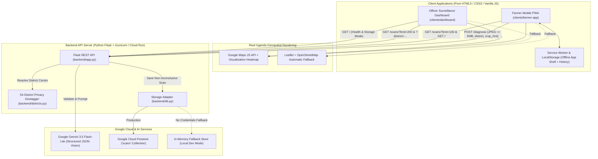
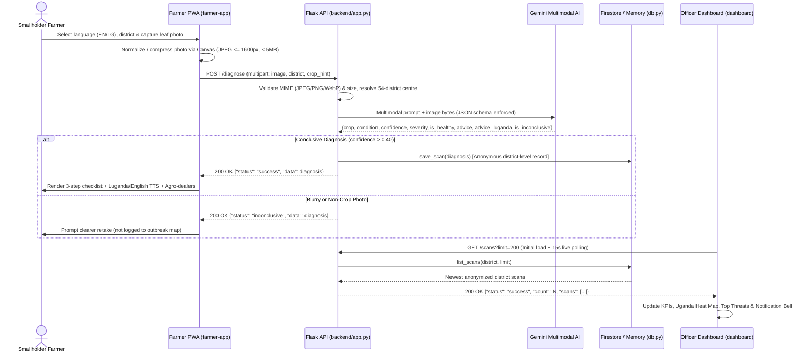
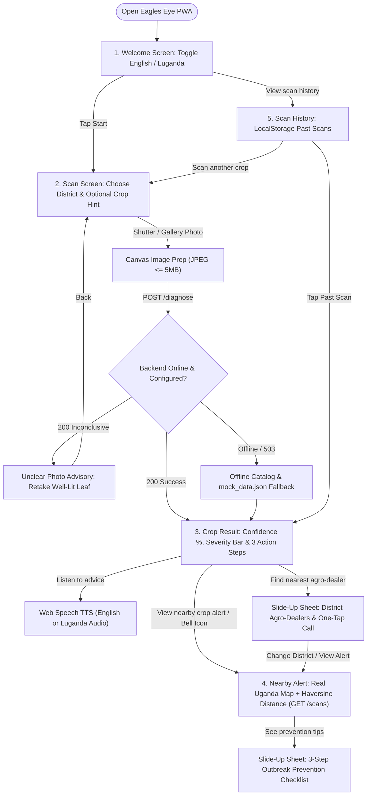
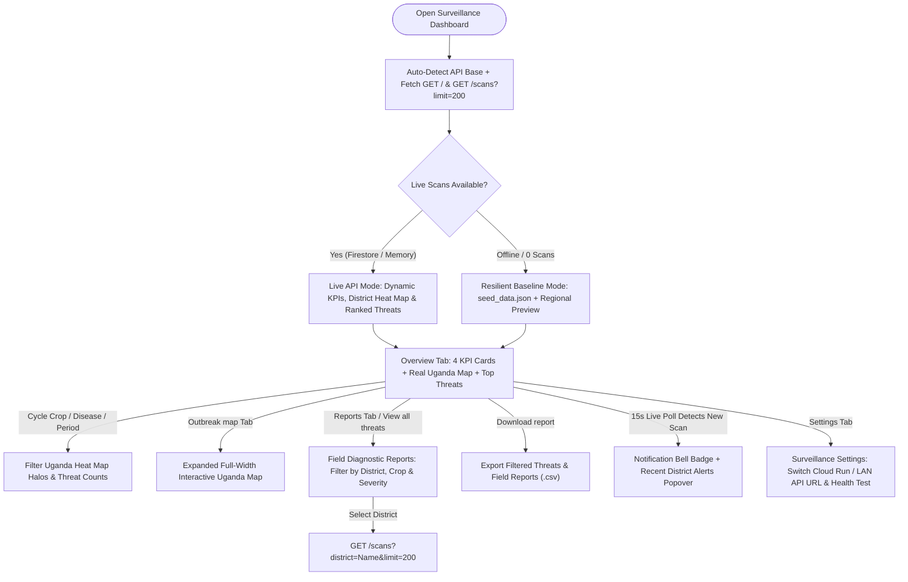

# 🦅 Eagles Eye

> **AI-Powered Crop Doctor & Outbreak Early-Warning System for Ugandan Smallholder Farmers**  
> Built by **Team Ugandan Eagles** for the **Pre-DevFest Hackathon Kampala 2026** (SDG Theme: Zero Hunger & Climate Action).

---

## 🌍 Overview

Smallholder farmers across Uganda lose an estimated **35–40% of their crop yields** to devastating diseases and pests (such as Banana Bacterial Wilt, Cassava Mosaic Disease, Coffee Leaf Rust, and Fall Armyworm). With agricultural extension officers spread thin across 146 districts, farmers frequently diagnose issues too late or apply ineffective treatments.

**Eagles Eye** bridges this gap through a privacy-first, three-tier intervention:

1. **Farmer Advisory Layer (Mobile Web / Offline-Ready PWA):** Farmers snap or upload a leaf photo, select their Ugandan district, and receive an instant multimodal AI diagnosis with 3-step treatment checklists, nearest agro-dealer contacts, nearby outbreak alerts, and **Text-to-Speech (TTS) audio guidance in English and Luganda**.
2. **Privacy-Preserving Community Outbreak Layer:** Confirmed diagnoses are anonymized at the **district administrative centre** level across 54 Ugandan districts (never storing photos, names, phone numbers, or exact homestead GPS coordinates) and logged to Google Cloud Firestore.
3. **Decision-Maker Surveillance Layer (Responsive Web Dashboard):** Agricultural extension officers, NGOs, and cooperatives monitor live KPI metrics, interactive real-map Uganda outbreak heat maps, ranked regional threats, district-filtered field reports, and CSV exports.

---

## 🏗 System Architecture



### End-to-End Diagnostic & Surveillance Data Flow



---

## 🧭 User Flow Diagrams

### 1. Smallholder Farmer Mobile App Flow (`clients/farmer-app/`)



### 2. Extension Officer Surveillance Dashboard Flow (`clients/dashboard/`)



---

## 📁 Repository Structure & Team Ownership

```text
eagles-eye/
├── backend/                        # Python Flask API + Gemini + Firestore (Derek & Lyazi)
│   ├── app.py                      # Flask routes: GET /, POST /diagnose, GET /scans
│   ├── db.py                       # Firestore persistence + automatic in-memory fallback
│   ├── districts.py                # 54 Ugandan district centres & input sanitization
│   ├── seed_firestore.py           # Demo outbreak seeder (--clear safe cleanup)
│   ├── Dockerfile                  # Production Gunicorn container for Google Cloud Run
│   ├── requirements.txt            # Python backend dependencies
│   └── .env.example                # Environment variable template
├── clients/                        # Pure HTML, CSS & Vanilla JS client applications
│   ├── farmer-app/                 # Farmer Mobile PWA (Deborah)
│   │   ├── index.html              # 5-screen mobile UI + agro-dealer & tips sheets
│   │   ├── style.css               # Responsive tokens (100dvh, safe-area, landscape mode)
│   │   ├── app.js                  # POST /diagnose, GET /scans, Luganda i18n, TTS, Uganda map
│   │   ├── manifest.json           # Installable PWA manifest
│   │   ├── sw.js                   # Offline app-shell Service Worker (eagles-eye-v5)
│   │   ├── mock_data.json          # Contract-aligned offline diagnosis fallback cases
│   │   └── assets/                 # Local crop sample imagery & app icon
│   └── dashboard/                  # Extension Officer Surveillance Dashboard (Odriann)
│       ├── index.html              # Responsive sidebar/top-nav dashboard layout
│       ├── style.css               # 5-breakpoint responsive layout (desktop -> 320px mobile)
│       ├── script.js               # Live KPIs, Uganda heat map, Top Threats, CSV, 15s sync
│       ├── seed_data.json          # Offline fallback outbreak records
│       └── assets/                 # Brand logo asset
├── shared/
│   └── assets/logo.png             # Single source of truth brand mark
├── data/
│   └── sample_crops/               # Reference crop imagery for evaluation
├── docs/
│   ├── DATA_CONTRACT.md            # Authoritative JSON schema, API & privacy specification
│   └── PROJECT_REPORT.md           # Full engineering, responsiveness & integration report
└── tests/
    ├── run_ai_tests.py             # Automated Gemini diagnosis evaluation runner
    ├── labels.csv                  # Reference ground-truth test labels
    └── reports/                    # Generated Gemini benchmark reports
```

### Team Roles & Ownership

| Team Member | Role | Component Ownership |
|---|---|---|
| **Stephen Wasswa** | Project Coordinator & Product Lead | Architecture, repo governance, UX consistency & pitch |
| **Atulinda Derek Solomon** | Backend Engineer | `backend/` (`app.py`, `db.py`, `districts.py`, `seed_firestore.py`) |
| **Lyazi Patrick** | AI & Security Specialist | `backend/` & `tests/` (Gemini multimodal prompting, safety & evaluation) |
| **Deborah Nzopi** | Frontend Developer | `clients/farmer-app/` (Farmer PWA, bilingual UX, camera upload, TTS audio) |
| **Twahirwa Odriann** | Dashboard Developer | `clients/dashboard/` (Surveillance dashboard, Uganda heat map, CSV reporting) |

---

## 📱 Responsiveness & Resilience Highlights

- **Multi-Tier Dashboard Layout (`clients/dashboard/style.css`):**
  - `>= 1200px`: Full desktop sidebar + 4-column KPI strip + split Uganda heat map & Top Threats panel.
  - `960px–1199px`: Compact sticky sidebar + `2×2` KPI grid + fluid map/threat columns.
  - `600px–959px`: Sticky frosted top bar with horizontal scrollable navigation pills + stacked Uganda map.
  - `< 600px` & `< 420px`: Full-width mobile controls, single-column KPI cards, viewport-safe notification popover, and notched-screen `env(safe-area-inset-*)` support.
- **Zero-Overlap Farmer PWA (`clients/farmer-app/style.css`):**
  - Uses `100dvh`, `clamp()` typography, a flex-column camera viewfinder (`.leaf-stage`), and dedicated landscape phone mode (`max-height: 540px`) so controls never clip on compact `320×568` devices.
- **Dual-Engine Real Uganda Maps:**
  - Renders interactive Uganda maps via **Google Maps JavaScript API** (with `HeatmapLayer` intensity gradients) and automatically falls back to **Leaflet + OpenStreetMap** (or an offline SVG schematic in the Farmer App when completely disconnected), backed by `ResizeObserver` viewport re-fitting.

---

## 🚀 Local Setup & Quickstart

### Prerequisites
- Python 3.10+
- Modern Web Browser (Chrome, Edge, Firefox, Safari)

### 1. Start the Backend API (`:8080`)
```bash
cd backend
python -m venv venv

# Windows (PowerShell):
.\venv\Scripts\Activate.ps1
# Linux / macOS:
source venv/bin/activate

pip install -r requirements.txt
copy .env.example .env   # (or cp .env.example .env) -> add your GEMINI_API_KEY
python app.py
```
- **Health check:** `http://localhost:8080/`
- **Crop diagnosis:** `POST http://localhost:8080/diagnose`
- **Surveillance scans:** `GET http://localhost:8080/scans?limit=200`
- *(Optional)* Seed demo records into Firestore: `python seed_firestore.py` (remove anytime with `python seed_firestore.py --clear`).

### 2. Launch the Farmer Mobile PWA (`:3000`)
```bash
python -m http.server 3000 -d clients/farmer-app
```
Open `http://localhost:3000` (or `http://<your-lan-ip>:3000` from a mobile phone on the same Wi-Fi — both apps automatically resolve `<hostname>:8080`, or accept `?api=https://your-cloud-run-url.run.app`).

### 3. Launch the Surveillance Dashboard (`:3001`)
```bash
python -m http.server 3001 -d clients/dashboard
```
Open `http://localhost:3001` to monitor live farmer scans, filter regional outbreaks, export CSV reports, or configure a remote Cloud Run API URL under **Settings**.

---

## 📜 Unified Data & AI Contract

All subsystems adhere strictly to [docs/DATA_CONTRACT.md](docs/DATA_CONTRACT.md). See [docs/PROJECT_REPORT.md](docs/PROJECT_REPORT.md) for the complete architecture, UI/UX responsiveness, and end-to-end integration report.

---

## 🛠 Google Technologies Used

- **Google GenAI SDK (`google-genai` / Gemini 3.5 Flash-Lite):** Structured JSON multimodal leaf diagnosis with bilingual English & Luganda farmer advisories and inconclusive-photo rejection.
- **Google Cloud Firestore:** Anonymous NoSQL persistence for district-level outbreak tracking (with zero-config in-memory fallback for local development).
- **Google Maps JavaScript API:** Real-time Uganda district outbreak markers, severity halos, and `visualization` heat map layers.
- **Google Cloud Run:** Containerized production deployment (`backend/Dockerfile` + Gunicorn).

---

## ⚠️ Advisory Disclaimer

Eagles Eye is a preliminary diagnostic advisory and community early-warning tool designed to support smallholder farmers. Always confirm treatment decisions with a certified local agricultural extension officer.
