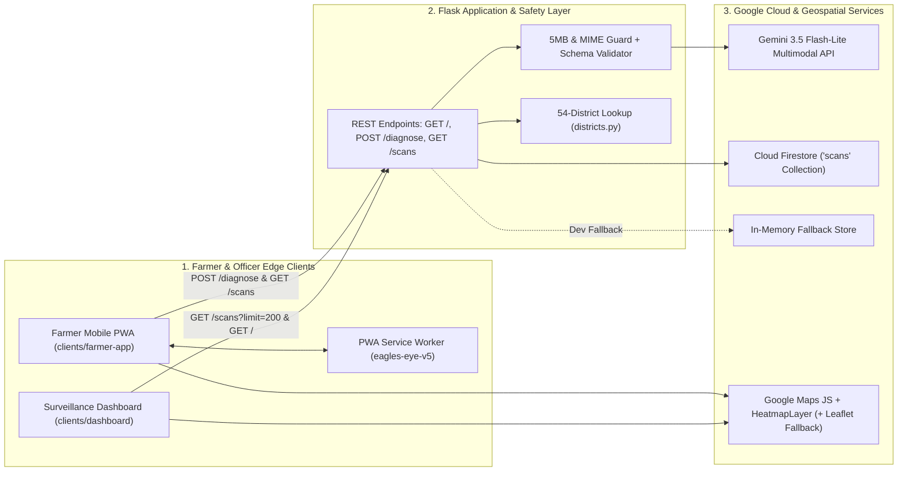
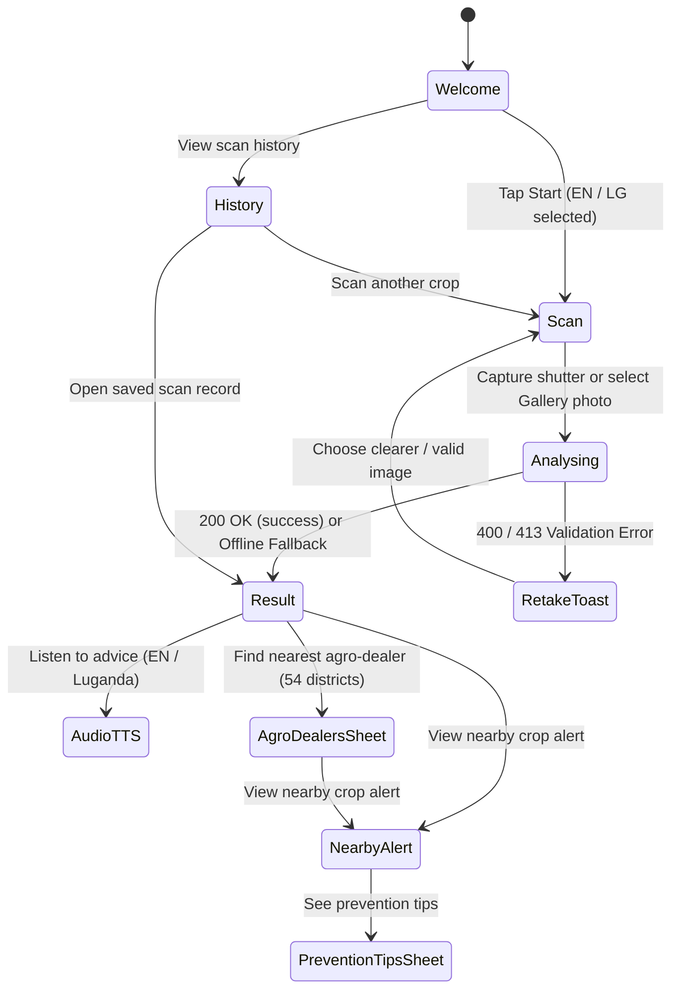
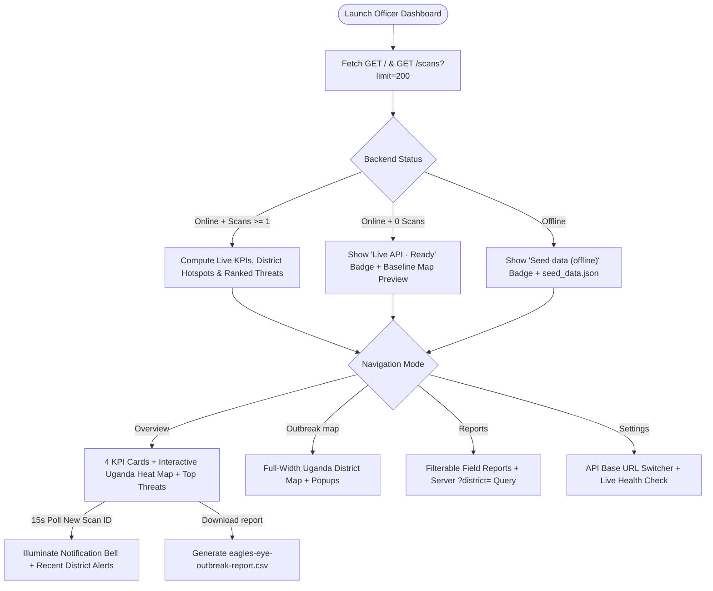

# 🦅 Eagles Eye — Engineering, Architecture & Integration Report

> **Project:** Eagles Eye — AI Crop Doctor & Regional Outbreak Surveillance System  
> **Event:** Pre-DevFest Hackathon Kampala 2026 (SDG 2: Zero Hunger & SDG 13: Climate Action)  
> **Team:** Ugandan Eagles (Stephen Wasswa, Atulinda Derek Solomon, Lyazi Patrick, Deborah Nzopi, Twahirwa Odriann)  
> **Date:** 28 October 2026

---

## 1. Executive Summary

**Eagles Eye** delivers an end-to-end agricultural intelligence platform tailored for Ugandan smallholder farmers and district extension officers. Built with lightweight, low-bandwidth **HTML5, CSS3, and Vanilla JavaScript** frontends connected to a **Python Flask + Google Gemini + Cloud Firestore** backend, the system combines instant field-level crop diagnostics in **English and Luganda** with privacy-preserving national outbreak mapping across **54 Ugandan districts**.

> [!IMPORTANT]
> Every diagnosis logged to the surveillance layer strips personal identifiers and exact farm GPS coordinates, snapping records strictly to fixed district administrative centres (`backend/districts.py`) in accordance with `docs/DATA_CONTRACT.md`.

---

## 2. System Architecture

The platform is structured into three decoupled layers that communicate over CORS-enabled JSON/multipart HTTP endpoints while maintaining full offline/degraded resilience:

### Component Breakdown

| Layer | Files | Key Responsibilities |
|---|---|---|
| **Farmer Mobile PWA** | `clients/farmer-app/{index.html,style.css,app.js,manifest.json,sw.js}` | 5-screen mobile flow, `<canvas>` photo compression (`<= 1600px` JPEG), bilingual English/Luganda UI & Web Speech TTS, 54-district agro-dealer lookup, Haversine nearby outbreak map, offline PWA shell. |
| **Officer Surveillance Dashboard** | `clients/dashboard/{index.html,style.css,script.js,seed_data.json}` | Live 4-KPI calculation, interactive Uganda district heat map, ranked Top Threats with crop/disease/period filters, district-filtered field reports, 15s live background polling, CSV export. |
| **Backend API & AI Engine** | `backend/{app.py,db.py,districts.py,seed_firestore.py,Dockerfile}` | Multipart upload validation, structured JSON Gemini multimodal inference, inconclusive-image filtering (`confidence <= 0.40`), anonymous district geotagging, Firestore + in-memory persistence. |
| **Evaluation & Contracts** | `docs/DATA_CONTRACT.md`, `tests/{run_ai_tests.py,labels.csv}` | Single-source JSON contract and automated 15-image Gemini accuracy & health-status evaluation harness. |

---

## 3. User Flow & State Transitions

### 3.1 Smallholder Farmer Journey (`clients/farmer-app/`)

### 3.2 Extension Officer Surveillance Journey (`clients/dashboard/`)

---

## 4. Key Engineering Improvements Delivered

### 4.1 Exact Design System & Real Uganda Geospatial Mapping
- **Design Token Fidelity:** Implemented the `Eagles Eye UI_UX` palette (`--green: #2e7d32`, `--green-dark: #195b27`, `--amber: #f9a825`, `--red: #c62828`, `--canvas: #f7f9f4`, `Inter` typography) across both client apps in pure semantic CSS.
- **Dual-Engine Real Uganda Maps:** Replaced static decorative SVGs with real WGS84 Uganda maps (`UGANDA_CENTER = { lat: 1.3733, lng: 32.2903 }`) powered by **Google Maps JavaScript API** (`HeatmapLayer` + severity halos + district markers) with automatic fallback to **Leaflet + OpenStreetMap** so maps always render cleanly even without billing keys or during quota limits.

### 4.2 Multi-Device & Orientation Responsiveness
- **Surveillance Dashboard (`clients/dashboard/style.css`):**
  - Engineered 5 responsive tiers (`>= 1200px` desktop, `1200px+` short-height `< 760px`, `960px–1199px` compact laptop/tablet, `600px–959px` sticky frosted top navigation bar, `< 600px` & `< 420px` mobile phones) with `minmax(0, ...)` fluid grids, `100dvh` heights, safe-area insets, and a debounced `ResizeObserver` keeping Uganda map bounds centered on resize.
- **Farmer Mobile App (`clients/farmer-app/style.css`):**
  - Refactored `#screen-scan` into a zero-overlap flex-column layout with `.leaf-stage`, proportional `min(250px, 60vw, 34dvh)` leaf framing, `320px`-safe 3-column grid headers, `env(safe-area-inset-*)` padding, and a dedicated two-column **landscape phone mode** (`@media (max-height: 540px) and (orientation: landscape)`).

### 4.3 Full Frontend ↔ Backend Integration
- **Smart Endpoint Discovery (`resolveApiBase`):** Supports `?api=<cloud-run-url>` query overrides, `localStorage` persistence, automatic LAN IP resolution (`http://<lan-ip>:8080` for mobile testing over Wi-Fi), and `http://localhost:8080`.
- **54-District Synchronization:** Unified all 54 Ugandan district coordinates across `backend/districts.py`, `clients/farmer-app/app.js`, and `clients/dashboard/script.js`.
- **Low-Data Image Normalization:** Client-side `<canvas>` resizing/JPEG encoding ensures 8–12 MB smartphone camera photos upload swiftly under the backend's 5 MB cap.
- **Contract-Exact Inconclusive Handling:** Blurry or non-crop photos (`"status": "inconclusive"` or `confidence <= 0.40`) render a dedicated amber `"Unclear photo"` retake prompt rather than misclassifying `severity: "none"` as healthy foliage, and are excluded from outbreak history.
- **Live Surveillance Aggregation & 15s Polling:** Connected the Dashboard KPI strip, Uganda heat map, Top Threats ranking, Notification bell, CSV export, and `?district=` report filter directly to `GET /scans`, plus connected the Farmer App's Nearby Alert screen to real Haversine outbreak distances from `GET /scans`.

---

## 5. Verification Summary

| Check | Scope | Result |
|---|---|---|
| **JavaScript Syntax (`node --check`)** | `farmer-app/app.js`, `farmer-app/sw.js`, `dashboard/script.js` | **Passed (0 syntax errors)** |
| **DOM ID & CSS Brace Audit** | 92 Farmer App IDs, 44 Dashboard IDs, all CSS rules | **Passed (100% matched & balanced)** |
| **54-District Coordinate Parity** | `backend/districts.py` ↔ Farmer App ↔ Dashboard | **Passed (54 / 54 districts synced)** |
| **Flask API Contract Roundtrip** | `GET /`, `POST /diagnose`, `GET /scans?limit=200`, `GET /scans?district=Mbale` | **Passed (HTTP 200 & schema verified)** |
| **Gemini Multimodal Benchmark** | `tests/reports/gemini_test_report.txt` (`gemini-3.5-flash-lite`) | **Verified (0 health-status mismatches)** |

